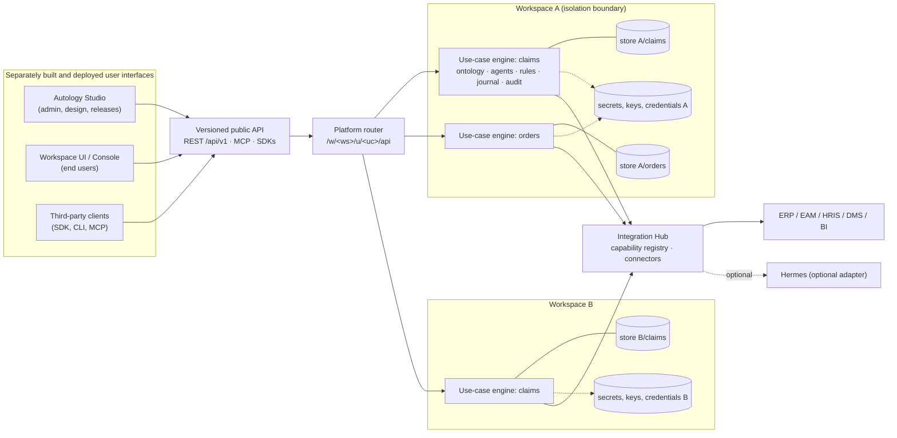

# Autology — target architecture

*Updated 14 November 2026 at `dfe8b3f`; Part B added 15 November 2026 (master directive V2). "Today" columns state
what exists and is tested; Part B states directions, not delivered capabilities.*

## 1. Components and responsibilities

| Component | Responsibility | Owns | Never does | Today |
|---|---|---|---|---|
| **Autology Engine** (headless) | Ontologies and knowledge graphs, planning, agent orchestration and delegation, rules and decision governance, identity-based authorisation, human approvals, action authorisation and the external-effects journal, audit, outcomes and replanning, automations and scheduling, readiness and deployment gates | Business decisions and every write | Render UI; trust a UI for policy | Exists; runs with no UI and no Hermes (`test_engine_headless.py`); gates not yet built |
| **Public API** | The only way in: REST (versioned), MCP, typed SDKs, CLI | The contract | Hold business logic | REST + MCP + SDKs exist; versioned contracts `/api/v1` and `/platform/v1` since 15 Nov (API-1/2) |
| **Platform router** | Resolve a token to one member of one workspace; route `/w/<ws>/u/<uc>/api`; per-workspace sign-in, keys, credential scope; access log | Membership and routing | Business rules; data outside the target use case | Exists (ISO-1–4) |
| **Autology Studio** | Administration and design: workspaces and use cases, versioned architecture, AI Solution Architect, visual model, discovery questions, templates, organisation and agent charts, integrations, readiness and releases | Draft configuration submitted for approval | Write engine storage; activate grants or releases itself | Next.js app (`studio/web`): catalogue, stages, read-only model, entity/relationship draft editor, blueprint proposals (not AI); no release, readiness or administration screens yet |
| **Autology Workspace UI** | End users: published processes, tasks, decisions, approvals, explanations | Presentation state | Decide policy; reach Studio functions | The Console (separate process, public API only); generated per use case in R5 |
| **Integration Hub** | Capability registry, connectors (read-only first), credential references, health; executes calls through the engine's journal | Connector definitions and declared effects | Orchestrate business processes; run a second scheduler | Tools, HTTP adapter with action safety, pipelines exist; registry and connectors in R4 |
| **Hermes** (optional, external) | Bounded tool execution or discovery when installed, through an adapter | Its own runtime | Decide, schedule business work, bypass policies, or be required | No dependency (tested); adapter in R4, after its interfaces are verified |

## 2. Diagram

## 3. Domain model

| Entity | Key fields | Relationships | Today |
|---|---|---|---|
| Platform | data dir, platform audit key | has workspaces | Exists |
| Workspace | id, name, members, secrets file, derived audit key, OIDC, credential prefix | has use cases, members | Exists (static configuration) |
| Member | name, token, workspace admin, per-use-case grants and `run_as` | belongs to one workspace | Exists (static configuration) |
| Service identity | name, roles, authorised agents | used by automations | Exists |
| Use case | id, name, engine configuration (ontology, agents, tools, rules, pipelines) | belongs to a workspace; has releases | Exists (no versions yet) |
| Release | use case, version, immutable snapshot, environment, approvals, evidence, score | promotion history | R2 (REL-1) |
| Industry blueprint | id, version, ontology patterns, processes, agent types, evidence needs; no customer data | instantiated into use cases | R2 (BP-1) |
| External call | idempotency key, run, step, tool, state, result, reconciliation | journal of a use case | Exists (ACT-1–5) |
| Agent spec | id, version, mission, scope, tools, limits, supervisor, gates, tests | part of a release | R4 |
| Capability | name, version, provider, schema, effects, scopes, idempotency, timeout, health | used by agent specs | R4 (tools exist; actions declare `side_effect` and `confirmation`) |
| Evidence item | metric, value, source, confidence, reviewer, refresh trigger | feeds readiness | R2 (REL-3) |

## 4. Isolation boundary (ADR-001, confirmed by D1)

**Decision.** A workspace is enforced by a **dedicated store per use case** under the workspace's directory,
per-workspace secrets, derived audit keys, sign-in and credential prefix, and an engine instance per use case that
only knows that workspace's members. The router resolves each token to exactly one member of one workspace. Use
cases of one workspace share nothing implicitly. Owner decision D1: designed for multi-tenancy; the first pilots
run as isolated deployments.

**Consequences.** Shared resources between use cases need an explicit, authorised mechanism (R2, with workspace
administration). Use cases per process are bounded by memory (each engine holds its graph). A PostgreSQL backend,
if D2 chooses it, keeps the same boundary with one schema or database per use case.

## 5. Data and action flows

1. **Read:** client → router (membership) → engine (permissions, row and field rules) → that use case's store.
2. **Decide:** planner → governance (requester ∩ agent roles) → human review → decision recorded → live data
   re-checked → resume → audit.
3. **External action (built):** intent with idempotency key committed → capability call → outcome classified →
   confirmation contract → `done`, or `uncertain` / `pending_confirmation` → reconciliation by a person → audit.
4. **Ingest:** pipeline, or Studio template upload (R3) → validate → quarantine → preview → confirmed commit →
   lineage → automations.
5. **Design (R2):** Studio → draft release → validation and evidence → approval → promotion through server-side
   gates → the engine loads the release.

## 6. UI separation: rules and status

| Rule (master prompt §2.2) | Status |
|---|---|
| No direct database access from a UI | Holds: the Console uses the public API only |
| No business rule only in a UI; governance server-side | Holds: the entry-point matrix runs against the API directly |
| No external side effect bypassing the engine | Holds: the UIs have no tool access |
| Independent frontend deployment and versioning | Console: separate process, same package. Studio: separate artefact (R2) |
| API version compatibility tests | Implemented 15 Nov (`tests/test_api_v1.py`: same handlers, legacy shape kept, envelope, paging, schemas, drift) |
| Backend works when the UI is unavailable | Verified (`test_engine_headless.py`) |
| Review inbox out of the engine process | Pending (UI-1); the inbox is optional today |

---

# Part B — Strategic directions (master directive V2, 15 November 2026)

Classification, as the owner asked: **Approved direction** (confirmed principle, suitable for architecture
planning), **Candidate** (needs technical and commercial validation), **Deferred** (premature or not differentiated).
None of these is an implementation mandate; each needs its own authorisation. Nothing below exists unless the
"Reuses today" column names code and tests.

## B1. Principles (approved directions)

1. Governance is mandatory; human intervention is optional and set by policy, risk and obligations. *Enforced
   today:* every step goes through `GovernanceLayer.evaluate` before any tool call (`agent.py` `_authorize` then
   `_execute`); a person is involved only when a `human_review` rule applies; machines cannot record human
   approvals (H-1/F-02, `tests/test_h1_approval_identity.py`).
2. An agent cannot grant itself permissions; AI output is a proposal, never an authorisation. *Enforced today:*
   requester ∩ agent roles (GOV-3/5), the assistant and MCP only propose (`tests/test_chat_safety.py`,
   `tests/test_mcp.py`), drafts never activate (`tests/test_studio2_modeling.py`).
3. Every consequential action passes through the Engine; results are verifiable and audited. *Enforced today:*
   journal intent before the call, idempotency keys, reconciliation, HMAC audit chains, sealed records.
4. Three application boundaries: Engine (authority), Studio (design, administration, release management),
   Workspace UI (operations). Studio and Workspace UI are separately deployable and never reach a store directly.
   *Today:* Studio and the Console use the API only (`tests/test_studio_separation.py`, e2e direct-call refusals);
   the Workspace UI is the optional built-in inbox plus the Console (no separate application yet).
5. Industry specialisation must not need a platform rewrite: it comes from configuration and, later, extensions.
6. Three approvals stay distinct: configuration **release** approval (REL-1a), **business action** authorisation
   (rules, stage), **runtime** approval (human review per run). A release approval authorises no business action
   (`tests/test_rel1a_releases.py` R9).

## B2. Core + Plugin Runtime ("everything is extensible except the Core governance and security kernel")

**Status: approved direction (long-term target); no migration authorised.** Assessment of today's extension points
(15 Nov audit, `audit/2026-11-15/AUTOLOGY_TECHNICAL_AUDIT_2026-11-15.md` §6):

| Concern | Reuses today | Missing for a plugin runtime |
|---|---|---|
| Discovery and loading | `adapters.import_target("module:attr")`, `load_tools` (python/http/table/registries), `load_reasoner`, `load_approver`, DB drivers by module name, SDK generators, blueprint glob | Manifest, registry, entry-point discovery, version and compatibility contract, signature verification, lifecycle (install, enable per workspace, disable, upgrade, rollback, revoke) |
| Contracts | `Reasoner`, `ChatModel` protocols; `ToolCall`/`ToolResult`; tool `environment`; ingest source types | Stable versioned SDK for capability discovery, policy checks, data access mediation, action requests, evidence, observability, errors |
| Isolation | none: imports run in-process with engine privileges | Out-of-process execution (separate process or container) for untrusted or third-party code; the Core mediates secrets, sensitive data and side effects. Application-level permission checks alone are **not** a sandbox for Python code |
| Governance of plugins | tool environments gated by stage; credentials scoped by workspace prefix (ISO-4) | Installing and activating a plugin as a governed, released operation (it would become part of the release snapshot) |

**Non-pluggable Core** (must stay authoritative and unbypassable): identity and authentication; workspace isolation;
authorisation; governance evaluation; autonomy and criticality enforcement; action authorisation and execution
boundaries; the durable action lifecycle and reconciliation; audit integrity; core schema, plugin contracts and
compatibility enforcement; secret access mediation; transaction consistency and recovery. A plugin may *request*
an action; it never authorises its own request.

**Plugin categories (concepts, not promises):** AI providers (D7/D10), knowledge/retrieval, industry knowledge
packs, integrations (Odoo, SAP, MES, OPC UA...), intelligence models (optimisation, anomaly detection, simulation),
business capabilities, Studio extensions, agent capabilities (approved skills and tools within Autology
orchestration).

**Dependencies:** REL-1a (a plugin set becomes part of a release), ADM-1 (who may install), D13 (secret store), an
isolation technology choice. **Security implications:** supply chain (signing, provenance, licences), privilege
separation, egress control per plugin (declared destinations, like F-01's origin rules). **Proposed phase:** a
design spike and a proof of concept (one AI-provider plugin loaded from a manifest, out of process, proving it
cannot call a tool or write the store except through the Core) after R2; runtime in R4 with the Integration Hub.
**Owner decisions:** isolation technology and hosting constraints; plugin signing authority; whether third parties
may publish plugins (commercial and legal, linked to D19).

## B3. Industry Standards & Compliance Hub and Industry Knowledge Packs

**Status: candidate capability (future strategic platform capability; no code today).** A pack would hold
applicable standards, regulatory requirements, technical rules, ontology extensions, terminology, processes,
operational constraints, validation rules, risk categories and source references; versioned, scoped and reviewable
on its own.

| Topic | Reuses today | Missing |
|---|---|---|
| Ontology extensions | ontology `imports`/`modules` composition (`ontology.py`), strict schema, blueprints (`autology/blueprints/`) | A pack format; applicability scope; supersession |
| Provenance | data lineage for ingested records (`/api/objects/{id}/lineage`); proposal provenance labels (`ai: false`) | Source identity, edition, publication and effective dates, jurisdiction, licence restrictions, extraction provenance, expert verification status, update history — for documents and requirements |
| From requirement to policy | rules are written in the ontology and reviewed through releases (REL-1a) | A review workflow that promotes only verified and explicitly approved requirements into enforceable rules; the Hub provides evidence and proposed rules, the Engine enforces (no second governance engine) |

Rules: uploading a standard does not make it accurate, licensed or binding; retrieving a rule is not compliance;
LLMs may propose extracted requirements, never enforce them; no ingestion of proprietary standards without rights.
**Dependencies:** document intake (R3), retrieval (B4), releases (REL-1a), D10 for any model processing.
**Security:** licence and confidentiality of sources; prompt injection from documents (GAP-045, SEC-A).
**Phase:** R3+ after document intake. **Owner decisions:** domains first, licensing of standards, expert reviewers.

## B4. Composable industry intelligence

**Status: approved direction for the principle (no single LLM as sole authority); candidate for each layer.**

| Layer | Today | Next step (candidate) |
|---|---|---|
| General-purpose LLMs | provider-neutral `Reasoner`/`ChatModel`; one Anthropic adapter tested with fake clients only (GAP-052) | AI-1: a second adapter and the same eval suite on both (D7/D10 configuration and keys) |
| Specialised industry LLMs | none | **Deferred** until measured quality, cost and operations justify it |
| Hybrid RAG with citations and source versions | none | Candidate after document intake; authorised sources only |
| Knowledge graph / GraphRAG | `KnowledgeGraph` queries, competency questions, RDF/JSON-LD export | Candidate: graph-grounded retrieval |
| Rules and policy models | governance rules, decision tables, expressions (deterministic) | — (Core) |
| Live enterprise data | ingest pipelines with lineage and watermarks; HTTP sources now origin-confined (F-01) | Freshness metadata on facts used by decisions |
| Simulation / digital twins | what-if scenarios (`scenarios.py`), simulated tools and stage | Candidate: impact analysis before consequential actions |
| Specialised analytical models | OR-Tools scheduling (`scheduling.py`) | Candidate: plugins (B2) |
| Controlled learning | outcome recording and analysis (`/api/runs/{id}/outcomes`) | Reviewed updates only; a learning loop never changes permissions or binding safety policies |

## B5. Decision & Action modelling

**Status: approved direction (requirement for the future ontology and Studio).** Today the ontology represents
entities, relationships, states, actions (with preconditions, reads, writes, effects, capabilities), rules
(prohibitions, human reviews, thresholds), goals, checkpoints, competency questions and side-effect declarations;
runs record decisions, reviews and outcomes. **Missing as first-class concepts:** business decisions with their
context, evidence requirements, responsible actors and verification criteria; risk classification of actions;
multi-step business operations spanning several systems with compensation. Multi-system operations are **not** one
ACID transaction: the Engine keeps durable execution, idempotency, outcome confirmation, reconciliation, and adds
explicit compensation per step (none exists today; audit F-14). **Dependencies:** REL-1a, criticality model (B6),
Studio Decision & Action Designer. **Phase:** R3–R4. **Owner decisions:** none to start the model design.

## B6. Criticality-aware autonomy

**Status: approved direction.** Modes: manual, AI-assisted, supervised autonomous, fully autonomous governed. Today
the outcome of governance is ALLOW / REVIEW / DENY per step, from rules with thresholds on facts; unknown facts
apply the restrictive rule; stages restrict which systems can be reached; machines cannot stand in for people.
**Missing:** a declarative criticality/risk classification per action (impact, obligations, operational
conditions, required evidence, approved autonomy level) evaluated by the Core; "simulation only" and "deferred"
outcomes as policy results. **Safety limits:** Autology does not replace certified safety functions, emergency
shutdown systems or flight-critical controllers; no claim of certification without independent evidence; autonomy
in regulated industries needs domain evidence and compliance processes. **Dependencies:** B5, REL-1a. **Phase:**
R3. **Owner decisions:** default autonomy level per risk class; sectors where a person is mandatory.

## B7. Ontology and semantic standards

**Status: candidate evaluation; the JSON Schema ontology stays the single source of truth.** RDF (interoperability),
SHACL (graph constraints), OWL (reasoning) and LinkML (schema generation) are not interchangeable; any adoption must
show constraint preservation, migration compatibility, performance, testability and maintainability, without a
permanent second source of truth. Today: RDF/JSON-LD export exists (lossy, GAP-027); no SHACL, OWL reasoning or
LinkML. **Phase:** a reversible experiment on synthetic data only, after R2.

## B8. Brainstorming kept separate

Commercial verticals, marketplaces and new business models discussed with the owner are **not** in the engineering
roadmap. They stay in product discussions until the owner authorises a mandate. Technical feasibility, product
desirability, commercial viability and deployment readiness are assessed separately.

## B9. Multi-tenant identity and access (approved direction D22)

Five identity categories, tenant above workspaces, no default platform-admin access to customer data, distinct
service identities for agents and plugins, RBAC + ABAC + autonomy policies enforced by the Engine. Existing
mechanisms, gaps and increments IAM-1…IAM-6: [IAM target](AUTOLOGY_IAM_TARGET.md).
