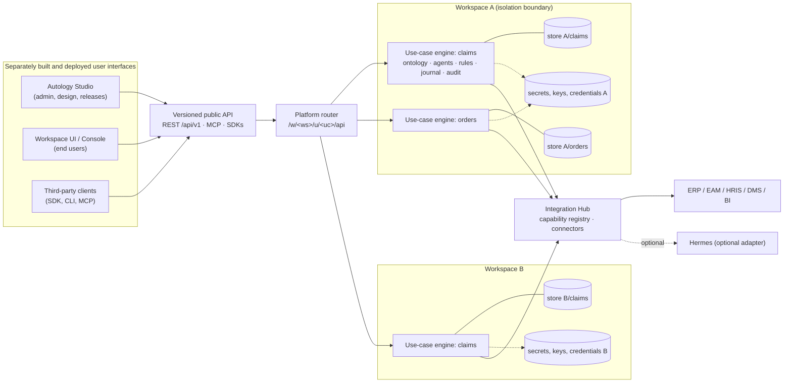

# Autology — target architecture

*Updated 14 November 2026 at `dfe8b3f`. "Today" columns state what exists and is tested.*

## 1. Components and responsibilities

| Component | Responsibility | Owns | Never does | Today |
|---|---|---|---|---|
| **Autology Engine** (headless) | Ontologies and knowledge graphs, planning, agent orchestration and delegation, rules and decision governance, identity-based authorisation, human approvals, action authorisation and the external-effects journal, audit, outcomes and replanning, automations and scheduling, readiness and deployment gates | Business decisions and every write | Render UI; trust a UI for policy | Exists; runs with no UI and no Hermes (`test_engine_headless.py`); gates not yet built |
| **Public API** | The only way in: REST (versioned), MCP, typed SDKs, CLI | The contract | Hold business logic | REST + MCP + SDKs exist; **no versioned contract yet** (API-1/2) |
| **Platform router** | Resolve a token to one member of one workspace; route `/w/<ws>/u/<uc>/api`; per-workspace sign-in, keys, credential scope; access log | Membership and routing | Business rules; data outside the target use case | Exists (ISO-1–4) |
| **Autology Studio** | Administration and design: workspaces and use cases, versioned architecture, AI Solution Architect, visual model, discovery questions, templates, organisation and agent charts, integrations, readiness and releases | Draft configuration submitted for approval | Write engine storage; activate grants or releases itself | Not started (R2) |
| **Autology Workspace UI** | End users: published processes, tasks, decisions, approvals, explanations | Presentation state | Decide policy; reach Studio functions | The Console (separate process, public API only); generated per use case in R5 |
| **Integration Hub** | Capability registry, connectors (read-only first), credential references, health; executes calls through the engine's journal | Connector definitions and declared effects | Orchestrate business processes; run a second scheduler | Tools, HTTP adapter with action safety, pipelines exist; registry and connectors in R4 |
| **Hermes** (optional, external) | Bounded tool execution or discovery when installed, through an adapter | Its own runtime | Decide, schedule business work, bypass policies, or be required | No dependency (tested); adapter in R4, after its interfaces are verified |

## 2. Diagram

## 3. Domain model

| Entity | Key fields | Relationships | Today |
|---|---|---|---|
| Platform | data dir, platform audit key | has workspaces | Exists |
| Workspace | id, name, members, secrets file, derived audit key, OIDC, credential prefix | has use cases, members | Exists (static configuration) |
| Member | name, token, workspace admin, per-use-case grants and `run_as` | belongs to one workspace | Exists (static configuration) |
| Service identity | name, roles, authorised agents | used by automations | Exists |
| Use case | id, name, engine configuration (ontology, agents, tools, rules, pipelines) | belongs to a workspace; has releases | Exists (no versions yet) |
| Release | use case, version, immutable snapshot, environment, approvals, evidence, score | promotion history | R2 (REL-1) |
| Industry blueprint | id, version, ontology patterns, processes, agent types, evidence needs; no customer data | instantiated into use cases | R2 (BP-1) |
| External call | idempotency key, run, step, tool, state, result, reconciliation | journal of a use case | Exists (ACT-1–5) |
| Agent spec | id, version, mission, scope, tools, limits, supervisor, gates, tests | part of a release | R4 |
| Capability | name, version, provider, schema, effects, scopes, idempotency, timeout, health | used by agent specs | R4 (tools exist; actions declare `side_effect` and `confirmation`) |
| Evidence item | metric, value, source, confidence, reviewer, refresh trigger | feeds readiness | R2 (REL-3) |

## 4. Isolation boundary (ADR-001, confirmed by D1)

**Decision.** A workspace is enforced by a **dedicated store per use case** under the workspace's directory,
per-workspace secrets, derived audit keys, sign-in and credential prefix, and an engine instance per use case that
only knows that workspace's members. The router resolves each token to exactly one member of one workspace. Use
cases of one workspace share nothing implicitly. Owner decision D1: designed for multi-tenancy; the first pilots
run as isolated deployments.

**Consequences.** Shared resources between use cases need an explicit, authorised mechanism (R2, with workspace
administration). Use cases per process are bounded by memory (each engine holds its graph). A PostgreSQL backend,
if D2 chooses it, keeps the same boundary with one schema or database per use case.

## 5. Data and action flows

1. **Read:** client → router (membership) → engine (permissions, row and field rules) → that use case's store.
2. **Decide:** planner → governance (requester ∩ agent roles) → human review → decision recorded → live data
   re-checked → resume → audit.
3. **External action (built):** intent with idempotency key committed → capability call → outcome classified →
   confirmation contract → `done`, or `uncertain` / `pending_confirmation` → reconciliation by a person → audit.
4. **Ingest:** pipeline, or Studio template upload (R3) → validate → quarantine → preview → confirmed commit →
   lineage → automations.
5. **Design (R2):** Studio → draft release → validation and evidence → approval → promotion through server-side
   gates → the engine loads the release.

## 6. UI separation: rules and status

| Rule (master prompt §2.2) | Status |
|---|---|
| No direct database access from a UI | Holds: the Console uses the public API only |
| No business rule only in a UI; governance server-side | Holds: the entry-point matrix runs against the API directly |
| No external side effect bypassing the engine | Holds: the UIs have no tool access |
| Independent frontend deployment and versioning | Console: separate process, same package. Studio: separate artefact (R2) |
| API version compatibility tests | Not started (API-1/2) |
| Backend works when the UI is unavailable | Verified (`test_engine_headless.py`) |
| Review inbox out of the engine process | Pending (UI-1); the inbox is optional today |
