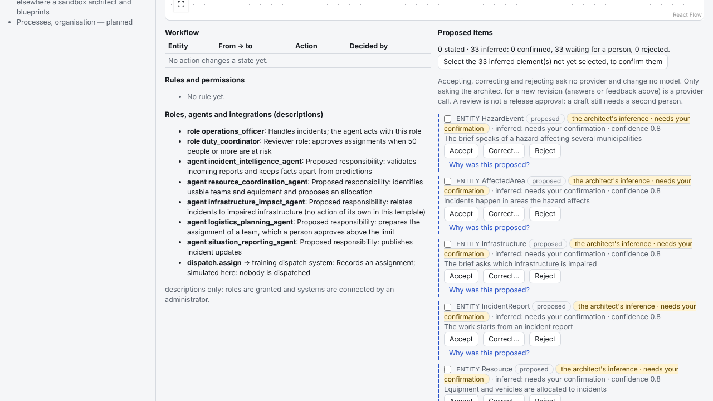
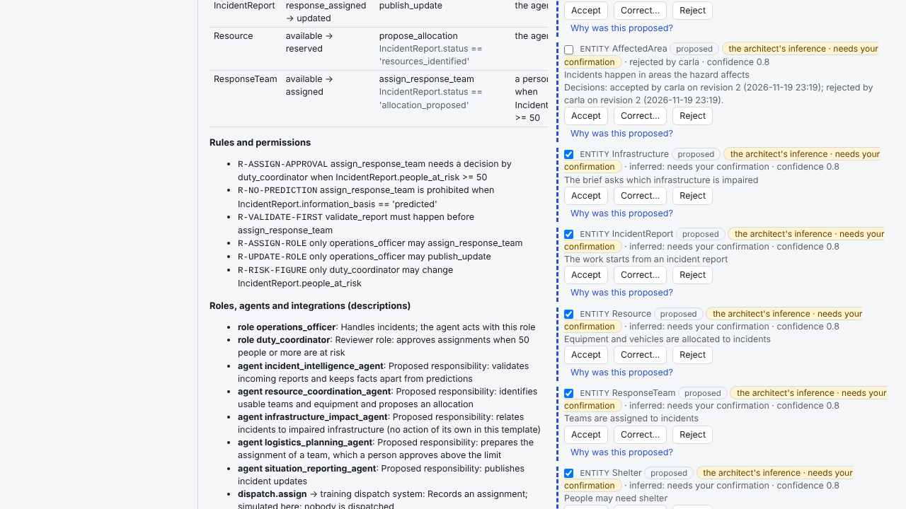
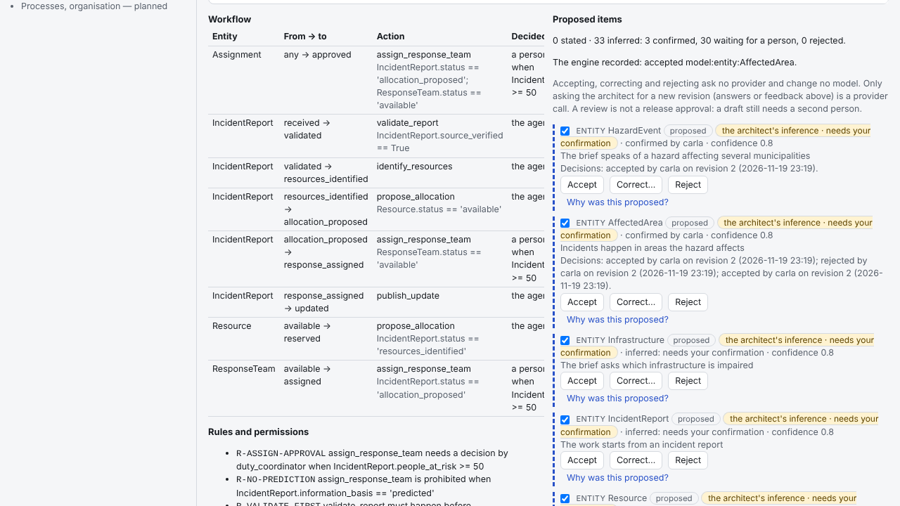
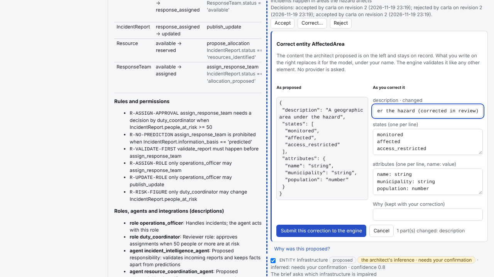
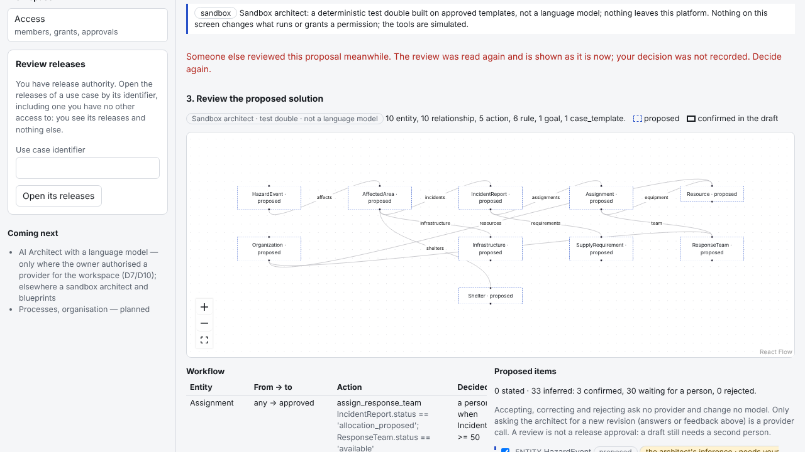

# Autology — R2: Provenance Integrity, Human Review UX & Governed Operations — report

*19 November 2026. Branch `claude/autology-ontology-agent-4ajjer`. Repository engineering only: synthetic data,
simulated tools, **no provider call, no credential read, the spending ledger not written**. Production execution
remains disabled. **R2 is not closed.***

## In one page

| Objective | Outcome |
|---|---|
| 1. Close GAP-107 safely | **Closed at the Engine for every element identical to one a stored proposal holds**, on every route that writes a draft, with or without a named proposal. Manual modelling still works and is attributed. **Not closable by engineering:** content retyped or reworded by hand cannot be proven to come from a proposal (GAP-109). That part is held behind an owner decision (D37 d) with the conservative default in force: attributed to the author, flagged, published only by a second person |
| 2. Close GAP-108 | **Closed.** Studio accepts, corrects and rejects single elements through the existing decision route. No second authority was added |
| 3. End-to-end provenance | Each element is traced over eleven links, from the brief to the simulated audit event. A missing link is written as missing. Three results stay apart; no total |
| 4. D24 / D34 | **Not approved, so not activated.** `records.create` and `records.update` do not exist; generated forms stay previews; designs stay drafts. Each prototype gained one refusal and a mapped test list |
| D36 | Decision sheet for each of a–e. **No approval was found; none is claimed.** D36 a is no longer as recorded: this sprint closed the exemption it left |
| D35 | Unchanged: one origin, simulation only. A verification plan per boundary was added. Nothing deployed |

What needs the owner's decision is in sections E (D36 and D37), F (D24 and D34) and G (D35).

Two things found on the way that the owner should know:

* **22 existing tests were using the bypass.** Their fixtures saved a proposal's content into a draft without any
  recorded review. With the gate in force they failed; the fixtures now record the review first. Nothing was
  deleted or loosened.
* **A defect of this sprint's own change, found before commit** (GAP-112): a configuration saved before any model draft
  produced a draft with no provenance, which the new publication gate would then have refused. Fixed and tested.

---

## A. Baseline and engineering evidence

### A.1 Baseline, verified directly before any change

| Item | Verified value |
|---|---|
| Starting commit | `b0e1fca` (documentation of the previous sprint), local = remote |
| CI on `b0e1fca` | [run 126](https://github.com/edlwiseltd/ontology/actions/runs/44626769503): success, five jobs |
| Last code commit before this sprint | `fe37691`; [run 125](https://github.com/edlwiseltd/ontology/actions/runs/44625037181): success. **Run 125 belongs to `fe37691`, not to `b0e1fca`** |
| Decisions | D24 not approved; D30 f inactive, g proposed, h not authorised; D34 pending; D35 and D36 awaiting confirmation. No approval of any found in the repository |
| Spending ledger | 27 entries, last written 17 November; 4.418875 USD of 10 USD consumed. Read-only check; unchanged at the end of the sprint |

### A.2 What changed

| | |
|---|---|
| Final code commit | `334b3e5` |
| Diff against `b0e1fca` | 50 files changed, 3,038 insertions, 76 deletions (five of the files are screenshots, two are generated evidence) |
| Store schema | 21 → **22** (one nullable column, `model_drafts.provenance`; additive; existing rows untouched) |
| API contract | Additive: `Draft.provenance`; `Proposal.review` and `corrections`; `expected_version` on a decision. Contract and generated client in step (checked by CI) |

### A.3 Verification on the final code

| Check | Result |
|---|---|
| Python suite, local, final tree | **1,155 tests, all passed**, 2 skipped locally (they need PostgreSQL; CI runs them); coverage **96.19 % (18,391 statements, 701 missed)** (gate: 95 %, not changed) |
| PostgreSQL | Runs in CI only, in both `test` jobs ("no test may be skipped"): both passed in run 127 (`test (3.10)`, `test (3.13)`), with the PostgreSQL service container |
| ruff | Clean |
| mypy ratchet | **198** = baseline (not raised) |
| Studio | Type-check clean; **85 unit tests** pass (81 before); build succeeds |
| Browser | **135/135** (Studio), **76/76** (cross-domain, includes the review journey in two domains; 60 before this sprint), **108/108** (applications) |
| Secrets | Six known values searched by value in 1,656 files: none found |
| Provider calls; credentials read; ledger writes | None; none; none |

### A.4 CI

| Commit | Run | Result |
|---|---|---|
| `b0e1fca` (baseline) | [126](https://github.com/edlwiseltd/ontology/actions/runs/44626769503) | Success |
| `334b3e5` (final code) | [127](https://github.com/edlwiseltd/ontology/actions/runs/44636770979) | **Success**, all five jobs (`quality`, `studio`, `package`, `test (3.10)`, `test (3.13)`) |

### A.5 Regressions and failures, as they occurred

| When | What | Resolution |
|---|---|---|
| First full run after the origin gate | 21 failures and 1 error in four modules (`test_act3…`, `test_act4…`, `test_arch1…`, `test_arch3…`): their shared fixtures saved an unreviewed proposal as a draft | The gate working as intended. Two fixtures now record the review; one test also asserts the 409 |
| Type ratchet | 199 errors (one new: a lambda in `chain_eval.py`) | Rewritten; back to 198 |
| While documenting the entry points | GAP-112 (see above) | Fixed; test added |
| Browser screenshots | The review screenshots showed the top of the page, not the element under review | The capture now follows the element; no check changed |

No test was removed, no threshold lowered.

---

## B. GAP-107 outcome

### B.1 Every way a draft is written

Found by searching `autology/` for every writer of the draft table (`save_draft`, `model_drafts`): five files,
three routes.

| Entry point | Code | Who | The caller controls | The Engine decides |
|---|---|---|---|---|
| `POST /api/v1/model/draft` | `AutologyService.save_model_draft` → `ArchitectService.save_draft` (`autology/architecting.py`) | A member holding `configure` | The document, a note, an optional `origin` | Provenance, refusals, the author (from the token) |
| `POST /api/v1/solution/draft` | `ConfigurationService.save_solution_draft` (`autology/configuring.py`) | The same | The configuration only; the model is carried over | `derived_revision`; earlier links carried forward |
| `POST /platform/v1/…/publish-draft` | `Platform.publish_draft` (`autology/platform.py`) | A **person** with release authority, **not** the author | A revision number | 403 / 409 (below) |

Nothing else writes a draft: no MCP tool, no command, no template, no import route. A template installs an active
model through the platform's governance. A restore brings rows back as they were.

### B.2 Threat model

| Threat | Answer | Residual |
|---|---|---|
| Leave the proposal reference out (GAP-107 itself) | Every draft is compared with every stored proposal | None |
| Name another proposal, or a stale revision | Checked against what the elements match; the revision found is recorded | None |
| Edit an element and keep the reference | Refused: an edit needs a recorded correction | None |
| Edit it and drop the reference; retype it; bring it from outside | Attributed to the author, flagged when it has a proposal element's identity; second person publishes | **Cannot be proven** (GAP-109, D37 d) |
| Claim "manual" in the request | No such field is read | None |
| Forge a decision, a time, an identifier | Never taken from a request | None |
| A service identity reviews or publishes | Both need a person: 403 | A service identity granted `configure` by two people may save a draft; it is classified like any other |
| Shorten the list of proposals a model rests on | The record only grows | None |
| A proposal of another workspace | Each use case has its own store: it does not exist there (400; 403/404 for the member) | None |
| Write into the database file directly | Outside the API; a row without provenance is not published | Operations, not this model |

### B.3 Origin classification (established by the Engine, never by the client)

| Mode | When |
|---|---|
| `architect_proposal` | At least one added or changed element comes from a stored proposal, confirmed |
| `manual_authoring` | Elements added or changed; none from a proposal. Author = the authenticated member |
| `derived_revision` | The model of the revision before, or the one that runs, unchanged |
| `imported_configuration` | Reserved; never assigned: there is no import route (GAP-110) |
| `legacy_unknown` | A row older than schema 22. Reported, never written into the row |

For a proposal-bound element the Engine rechecks identity **and** content: identical to a kept element (stated and
not rejected, accepted, or corrected to exactly this) or refused. The content from before a correction is refused.

### B.4 Legacy drafts

The migration adds one column and writes nothing into existing rows: no approval, origin event or link is
fabricated. A legacy draft is **not published** (409) and **not built upon**: saved again, it is compared with the
model that runs, unconfirmed proposal elements are refused, and what is left is attributed to the person who saved
it (`reestablished_from_legacy`). Approved releases and their fingerprints are untouched. Software from before
refuses a schema-22 store instead of misreading it; going back means restoring the backup, as for every schema
step. **Who answers for a legacy draft's content is a policy choice: D37 c.**

### B.5 Enforcement points and outcomes

| Point | Outcome |
|---|---|
| `ArchitectService.save_draft` → `proposal_review.classify` | 409 with the list of elements and reasons; nothing saved. 400 for an `origin` that does not exist here |
| `ArchitectService.decide_proposal` | 403 unless a person holding `configure`; 409 when the review moved on; 400 for unknown elements |
| `Platform.publish_draft` and its route | 403 for the author, a service identity, a member without release authority; 409 for unestablished provenance or an invalid model |
| Audit | Every draft revision keeps its provenance record (append-only table); every decision and correction is an append-only, attributed row |

### B.6 The fourteen negative tests (through the API; `tests/test_gap107_draft_origin.py`, 10 tests)

| # | Case | Result | Test |
|---|---|---|---|
| 1 | No proposal reference, unconfirmed element | 409 | `test_naming_no_proposal_changes_nothing` |
| 2 | Swapped proposal | 409 | `test_a_swapped_foreign_or_stale_reference` |
| 3 | Another workspace or tenant | 400; 403/404 | same |
| 4 | Stale revision; modified element | Recorded as found; 409 | same |
| 5 | Inferred without a decision | 409 | `test_naming_no_proposal_changes_nothing` |
| 6 | Rejected, then proposed again | 409 | `test_rejected_then_proposed_again_and_corrected_then_changed` |
| 7 | Corrected, then changed | 409 | same |
| 8 | Client claims "manual" | Ignored; 409 or recorded as found | `test_naming_no_proposal_changes_nothing` |
| 9 | Legitimate manual draft | 200, attributed, published by another person | `test_a_model_authored_by_hand_is_saved_attributed_and_published_by_another_person` |
| 10 | Legacy, uncertain provenance | Not published; re-established or refused | `test_a_draft_of_unknown_provenance_is_not_published_and_not_built_upon`; `test_a_store_of_the_schema_before_is_upgraded_without_inventing_any_provenance` |
| 11 | Service identity reviews or promotes, **also when it holds `configure`** | 403 | test of case 9 |
| 12 | Cross-workspace link; forged time or decision | Refused or ignored | `test_forged_decision_fields_are_not_taken` |
| 13 | Broken dependents | Named, then refused at publication | `test_a_decision_that_leaves_a_relationship_without_its_entity` |
| 14 | Publication without a second person | 403 | tests of cases 9 and 13 |

Intentionally unsupported: importing a draft (no route); proving the origin of hand-typed text.

### B.7 Is the gap closed?

**Closed** for what it was registered as: omitting the reference no longer escapes the review. **Blocked by an
owner policy decision** for the neighbouring question it exposed: what to do about an element that has a proposal
element's identity and different content, in a draft that names no proposal (D37 d). The default in force is
conservative and documented; no organisation-wide policy was invented.

---

## C. GAP-108 outcome: correcting an element in Studio

### C.1 Walkthrough (one reviewer; as exercised by the browser tests in two domains: crisis management and network intelligence)

| Step | What the reviewer sees | What happens |
|---|---|---|
| 1 | Each element: type and name, basis (stated or inferred), what it cites, where it stands, findings, what depends on it, history | Read from the Engine |
| 2 | **Accept**, **Correct**, **Reject** on each element | One call each to `POST …/proposals/{id}/decision` |
| 3 | Correct: the proposed content on the left, structured fields on the right | Text, lists, pairs, flags, numbers. No executable text. A field that breaks the element's shape is refused in the editor |
| 4 | Deliberate submit; the button is off until something changed | The correction is sent with the review version the reviewer read |
| 5 | "Recorded by the Engine", the element as corrected, the reviewer's name and the time | Shown only after the Engine answered and the review was read again |
| 6 | What became invalid, and which accepted elements now lack something | From the Engine's review (`dependency_failures`, the loader's verdict) |
| 7 | A note: decisions and corrections ask no provider; a new revision would | No provider call is made |
| 8 | "A review is not a release approval" | A draft still needs a second person; a release still needs approval |

### C.2 Screens (browser tests of 19 November 2026; synthetic data)

**1. A proposal as it opens: nothing inferred is selected; each element says where it stands and has its three decisions**

**2. One element rejected: recorded by the Engine at once, with who and when**

**3. Accepted again: the history keeps every decision in order**

**4. Correcting: the proposed content on the left, structured fields on the right, what changed beside the submit button**

**5. Another reviewer decided meanwhile: nothing was recorded, the review was read again**

### C.3 Properties

| Property | Evidence |
|---|---|
| Attribution: who and when, from the token and the Engine's clock | `tests/test_rev1_proposal_review.py::test_review_through_the_api_persisted_attributed_and_enforced`; browser: "a correction is made in fields beside the proposed content…" |
| History: every decision kept, in order | Browser: "accepting it again is a new decision beside the earlier ones: the history keeps all three in order, with who and when" |
| Concurrency: a stale decision is refused, the review reloaded, never overwritten | Browser: "when someone else reviewed meanwhile, the decision made here is refused, the review is read again, and deciding again works" |
| Persistence: after reload, reopening and a server restart | `test_review_through_the_api_persisted_attributed_and_enforced` (restarts the platform); browser: "read again from the engine, the review is as it was left…" |
| Dependency revalidation | Browser: "rejecting one element is recorded by the engine at once, unselects it, and the review names the accepted element that now lacks it" |
| Unauthorised reviewer, other workspace, service identity | Browser: "a member of another workspace and a member without the right decide nothing about this proposal"; `test_gap107…` case 11 |
| Keyboard | Browser: "the three decisions of an element are buttons reachable by keyboard, each named for the element it decides" |
| Readable errors | The Engine's refusal is shown in words (conflict, no right, invalid correction) |
| No second authority | `studio/web/lib/api.ts` calls the one decision route; `studio/web/tests/correction.test.ts` (4 tests) covers the field logic only |

Not done: a full accessibility audit (keyboard reachability and labels were tested; screen-reader behaviour was
not), and usability testing with real reviewers.

---

## D. Traceability and AI assessment

### D.1 The chain, per element

`chain_eval.trace` extends `proposal_review.traceability`; neither was replaced. Eleven links: source,
suggestion, evidence, clarification, decision, draft, validation, release, application, simulated action, audit.
A missing link is written `missing: <why>`. The trace holds element names only, never a record or a value, so it
shows nothing a field or row rule hides.

| Answer traced | Elements | Complete lines | Missing |
|---|---|---|---|
| Reserved brief `museum-loans` (**reference answer, not a model**), synthetic reviewer's decisions | 13 | 0 | Release for all 13 (the evaluation releases nothing); audit for 11 (only executed actions leave an event); the one unconfirmed inferred rule from the decision onward |
| Kept ground-handling journey (a real model's stored proposal), decisions on record | 40 | 0 | **Source and evidence for all 40**: stored before evidence was kept; none reconstructed (GAP-111). Decision on record for all 40 |

So the honest answer to "is every accepted component traceable?" is: to a recorded decision, yes; to a source,
only for proposals stored since evidence is kept.

### D.2 Three results, kept apart (no total)

| | A. AI Architect | B. Application Builder | C. Engine |
|---|---|---|---|
| Reserved brief, reference answer | Not a model: nothing to assess | Manifest valid in every scenario where a draft exists | Draft accepted except after the illustrative rejection |
| Run 2's kept answers (real model, 17 Nov) | 4 of 5 answered; 114 elements, 41 inferred | 1 manifest alone; 4 as a counterfactual | **1 of 4** drafts accepted alone; **4 of 4** only as a counterfactual |
| Ground-handling journey (real model) | 40 elements, 23 inferred | Valid with the recorded decisions | Refused with none; accepted with the 22 of 23 on record |

### D.3 Six replay scenarios (`planning/evidence/provenance-2026-11-19/`)

| # | Scenario | Label | Result on `museum-loans` |
|---|---|---|---|
| 1 | None confirmed | Evidence of the answer alone | 0 of 3; accepted |
| 2 | Recorded, attributable confirmations only | A synthetic reviewer written with the case | 2 of 3; accepted |
| 3 | All confirmed | **Counterfactual. Not evidence that anything is right** | 3 of 3; accepted |
| 4a | A rejection | Illustrative decisions; no person made them | Two dependents named; draft refused |
| 4b | A correction | The same | Validated again; accepted |
| 5 | Authored by hand, no proposal | — | `manual_authoring`; architect not applicable |
| 6 | Legacy, uncertain origin | — | `legacy_unknown`; may not be published |

A test compares the kept files with what the harness produces today
(`test_the_six_replay_scenarios_kept_as_evidence_are_what_the_harness_gives_today`).

### D.4 What is not established

* **No independent domain expert has reviewed any model.** Engine acceptance means a model loads and runs. A
  member's confirmation means a member confirmed. Neither is semantic correctness.
* No real model has answered the reserved briefs: not authorised.
* A rubric and an evidence package for future reviewers are prepared
  (`planning/AUTOLOGY_DOMAIN_EXPERT_REVIEW_REQUIREMENTS.md`, Part C). Nobody filled it in.
* No earlier score was rewritten; no held-out case was modified; protocol V1 is unchanged, V2 stays proposed
  (D30 g), element-level recovery of non-conforming provider output stays inactive (D30 f).

---

## E. D36 ratification package

Full sheets (rationale, evidence, compatibility, rollback, effect of reversing):
`planning/AUTOLOGY_D36_RATIFICATION_PACKAGE.md`. **No owner approval of D36 was found, and none is claimed.**

| # | Default | Still the actual behaviour? | Compatibility risk | Proposed |
|---|---|---|---|---|
| a | A draft takes no rejected or unconfirmed-inferred element from a proposal | **Changed: strengthened.** The recorded exemption for a draft naming no proposal was GAP-107 and is gone | Clients that saved unreviewed proposals get 409 (22 of our own tests did) | Confirm with D37 a |
| b | Studio selects nothing inferred | Yes | One more click | Confirm |
| c | A decision is about the element as shown; rejected stays rejected | Yes | Reviewers decide again on changed elements | Confirm |
| d | A person may correct an element | Yes; now also in Studio | Additive | Confirm |
| e | The runtime draws manifest format 1 for Engine API 1 only | Yes | A future format needs a runtime that states it | Confirm |

New defaults of this sprint, recorded as **D37** (not owner decisions):

| # | Default | Proposed |
|---|---|---|
| a | The Engine establishes the provenance of every draft | Confirm |
| b | No publication without an established provenance | Confirm |
| c | A legacy draft saved again is classified again; the rest is attributed to who saved it | **Owner's choice:** as applied; or an administrator's recorded acknowledgement first; or refuse legacy drafts |
| d | Same identity, other content, no proposal named: saved as the author's own and flagged | **Owner's choice:** as applied; or refuse; or also show the flags to the second person at publication |
| e | `expected_version` on a decision is optional (Studio always sends it) | Confirm, or make it mandatory |

---

## F. D24 and D34

### F.1 D24 — create and update by ordinary users

| | |
|---|---|
| Approval found | **None.** Not activated |
| In force | `records.create`, `records.update` and `operate` are not permissions (a grant naming one is 400). An application user's write is 403. Every generated form is a preview. Delete and archive are exposed nowhere |
| Delivered | Final design, threat model and implementation plan (`planning/AUTOLOGY_D24_APPLICATION_PERMISSIONS_PROPOSAL.md`); the inactive policy (`autology/operation_policy.py`, called by nothing that runs) with the outcome contract requested / accepted / refused / simulated |
| Added | A field hidden from the caller is not written by the caller. The directive's ten test items mapped to the prototype's 16 tests (`tests/test_d24_operation_policy.py`) |
| What the tests prove | The semantics. **Not** an implementation: there is none |
| Decision needed | D24 a: approve the three record rights as specified, or not |

### F.2 D34 — designs as approved release artifacts

| | |
|---|---|
| Approval found | **None.** The lifecycle is inactive |
| In force | A design is a draft the Engine keeps. The Engine reports "approved release artifact: not supported", and the screens print it. Nothing presents a draft as published |
| Delivered | Migration-ready design: the record, the release structure with a combined fingerprint, the migration of existing drafts (`planning/AUTOLOGY_D34_GOVERNED_APPLICATION_DESIGN_PROPOSAL.md`); the inactive prototype (`autology/design_governance.py`) |
| Added | A release of another workspace or use case is refused. The eight negative cases (self-approval, service identity, manifest changed after approval, stale release, rollback, suspension and resumption, foreign workspace, production) mapped to 12 tests (`tests/test_d34_design_governance.py`) |
| Decision needed | The seven questions of the proposal, Q1 first |

---

## G. D35 — runtime separation

| | |
|---|---|
| Status | **Simulation only, one origin, unchanged.** Nothing deployed; no identity policy modified |
| In force | The runtime refuses a manifest format or Engine API it was not built for; it keeps its own token key, asks only its use case's versioned API, and is opened without an opener (`studio/web/tests/runtime.test.ts`, `forward.test.ts`) |
| Not a security boundary | Studio and the applications share an origin: a script on it can read both tokens in a tab that used both. The Engine's authorisation is the boundary |
| Added | A verification plan per boundary (origins, sessions, token scope, relay, content security policy, versions, rollback) in `planning/AUTOLOGY_D35_RUNTIME_SEPARATION_ASSESSMENT.md` §4b. None of these tests can pass before the corresponding step is approved and built |
| Decision needed | Confirm one origin for simulation only; approve two roles and two origins; take plane-scoped tokens into the identity roadmap |

---

## H. Twelve explicit answers

| # | Question | Answer |
|---|---|---|
| 1 | Can an AI-derived draft be saved without a valid proposal binding? | **Not with elements identical to a stored proposal's unconfirmed or rejected ones**: the Engine finds them whether or not a proposal is named (409). **Yes, if a person retypes or rewords them**: that cannot be detected; it is attributed to that person, flagged when the identity matches, and published only by a second person |
| 2 | Is manual or imported modelling still legitimate and traceable? | Manual: yes, saved, attributed to the authenticated author, recorded as `manual_authoring`, published by another person. Imported: there is no import route for drafts; the mode is reserved |
| 3 | Can Studio correct, reject and accept individual elements, preserving history? | Yes, through the existing Engine route; every decision is kept, attributed and timed, and survives a restart |
| 4 | Do revisions invalidate stale confirmations and dependents? | Yes. A decision holds only while the element is unchanged; a changed element is undecided again; a decision made over a stale review is refused; dependents of a rejected element are named and the draft is refused |
| 5 | Is every accepted component traceable to a source or a recorded assumption, and a decision? | To a decision: yes. To a source: yes for proposals stored since evidence is kept; **no for the kept ground-handling journey** (40 elements without a source link, shown as missing) |
| 6 | Is semantic correctness independently verified, or only Engine validity? | **Only Engine validity.** No independent expert review has taken place |
| 7 | Do accepted models still generate deterministic governed applications? | Yes: manifests valid and deterministic in every scenario with an accepted draft; 108 application browser checks on three domains and both reserved briefs |
| 8 | Can ordinary users create and update with least privilege, and under what approval? | **No.** Not active. It needs D24 a, which was not found |
| 9 | Are designs approved release artifacts, and under what approval? | **No.** They are drafts. It needs D34, which is pending |
| 10 | Is the runtime isolated at browser and identity level? | **No.** One origin, one kind of token. The Engine's authorisation is the only boundary. Separation needs D35 |
| 11 | Which decisions and tests block production? | Decisions: D24, D26, D30 f/g/h, D31 to D37, D19 (licence), D23. Evidence: an independent security review; an independent semantic review; origin and token separation with their tests; a production-sized restore drill; real integrations in a sandbox of the real systems. Production is refused by the Engine regardless |
| 12 | Is R2 formally ready to close under roadmap §3.5? | **No.** Unmet: the owner's decisions listed above; ARC-0 only partial; readiness weights unconfirmed (D26); the architect's path on a real provider beyond the one authorised evaluation; no independent semantic review; D35 separation not built |

## Definition of done

| # | Item | State |
|---|---|---|
| 1 | Verified baseline and threat model before code | Done (A.1, B.2) |
| 2 | GAP-107 closed, or held behind a documented owner decision with fail-closed behaviour | Closed for identical content; the remainder held behind D37 c and d |
| 3 | GAP-108 closed through the existing API | Done |
| 4 | Traceability extended, missing links shown | Done |
| 5 | Three result categories kept apart; counterfactuals labelled | Done |
| 6 | No provider call; ledger untouched | Confirmed |
| 7 | D36 status truthful; no implicit ratification | Done (E) |
| 8 | No unapproved D24 / D34 / D35 functionality active | Confirmed by tests that nothing in `autology/` uses the prototypes |
| 9 | Coverage gate 95 % and mypy 198 unchanged; no test deleted | Confirmed |
| 10 | Shared Engine, Builder, Studio and runtime across all domains; no domain logic in them | The vocabulary and opaque-name tests pass; the review journey runs in two domains, and the applications in three plus both reserved briefs, through the same code |
| 11 | Final code commit passes CI | **Success**, all five jobs (`quality`, `studio`, `package`, `test (3.10)`, `test (3.13)`) ([run 127](https://github.com/edlwiseltd/ontology/actions/runs/44636770979)) |
| 12 | Production disabled; R2 closure not claimed | Confirmed |
