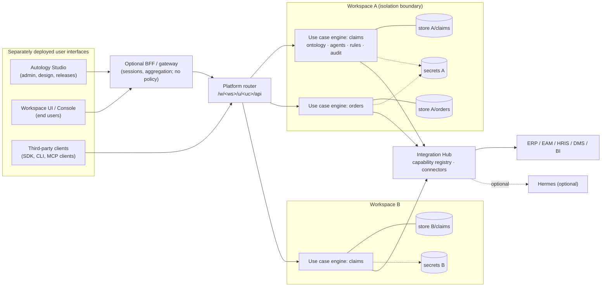

# Autology — target architecture

## 1. Components and responsibilities

| Component | Responsibility | Owns | Never does |
|---|---|---|---|
| **Autology Engine** (headless) | Ontology, planning, agent orchestration, governance, approvals, execution state, audit, ingestion, server-side release gates | Business decisions and every write | Render UI; trust a UI for policy |
| **Platform router** (exists, Phase 1) | Resolve the caller to one workspace member; route `/w/<ws>/u/<uc>/api` to that use case's engine; log refusals | Workspace membership and routing | Business rules; data access outside the target use case |
| **Autology Studio** (planned) | Administration and solution design: workspace and use-case catalog, AI Solution Architect, ontology designer, template packs, org charts, agent factory, integration setup, readiness and releases | Draft configuration it submits for approval | Write engine storage; activate grants or releases itself |
| **Autology Workspace UI** (Console today) | End-user runtime: cases, tasks, reviews, results, "why" explanations | Presentation state only | Decide policy; reach Studio functions |
| **Integration Hub** (partly: tools, ingestion) | Capability registry, connectors (read-only first), secrets references, health | Connector definitions and their declared effects | Orchestrate business processes; hold a second scheduler |
| **Hermes** (optional, external) | Bounded tool execution or discovery when installed | Its own runtime | Decide, schedule business work, or be required |

## 2. Diagram

## 3. Domain model

| Entity | Key fields | Relationships | Status |
|---|---|---|---|
| Platform | data dir, audit key, blueprint catalog | has workspaces | router exists |
| Workspace | id, name, members, secrets file, quotas (planned) | has use cases, members | **exists** |
| Member | name, token, workspace admin, per-use-case grants | belongs to one workspace | **exists** (static config) |
| Use case | id, name, engine config (ontology, agents, tools, rules, pipelines) | belongs to a workspace; has releases | **exists** (no versions yet) |
| Release | use case, version, immutable snapshot, environment, approvals, evidence, score | promotion history | planned |
| Industry blueprint | id, version, ontology patterns, processes, agent types, evidence needs | instantiated into use cases | planned |
| Agent spec | id, version, mission, scope, tools, limits, supervisor, gates, tests | part of a use case release | planned |
| Capability | name, version, provider, schema, effects, scopes, idempotency, timeout, health | used by agent specs | planned (tools exist) |
| Evidence item | metric, value, source, confidence, reviewer, refresh trigger | feeds readiness | planned |

## 4. Isolation boundary (decision ADR-001)

**Decision.** A workspace is enforced by a **dedicated store per use case** under the workspace's directory, a
per-workspace secrets file, and an engine instance per use case that only knows that workspace's members. The
router resolves each token to exactly one member of one workspace.

**Why.** It isolates by construction with the existing, audited engine unchanged (no `workspace_id` threaded
through 60 store methods), matches the "dedicated database" mode the instructions allow, and makes per-customer
deployment (audit decision D1) a special case (one workspace per platform).

**Consequences.** Shared resources between use cases need an explicit sharing mechanism (planned). The number of
use cases per process is bounded by memory (each engine holds its graph in memory). A PostgreSQL backend, if
chosen later, keeps the same boundary with one schema or database per use case.

## 5. Data and action flows

1. **Read**: client → router (membership) → engine (permissions, row/field rules) → store of that use case.
2. **Decide**: engine planner → governance → human review (inbox/Console) → resume → audit.
3. **External action** (target, after GAP-001–007): engine writes an intent with an idempotency key → capability
   call → confirmation contract → `done`, or `uncertain` → reconciliation → audit.
4. **Ingest**: pipeline (or Studio template upload, planned) → validate → quarantine → preview → governed commit →
   lineage → automations.
5. **Design** (planned): Studio → draft use-case release → validation and evidence → approval → promotion API →
   engine loads the release.

## 6. UI separation path

The Console already talks only to the public API, through its own server. Remaining steps: move the review inbox
out of the engine process (keep it as a separately served app), publish an OpenAPI contract per API version with
compatibility tests, and give Studio and the Workspace UI their own build artifacts.
